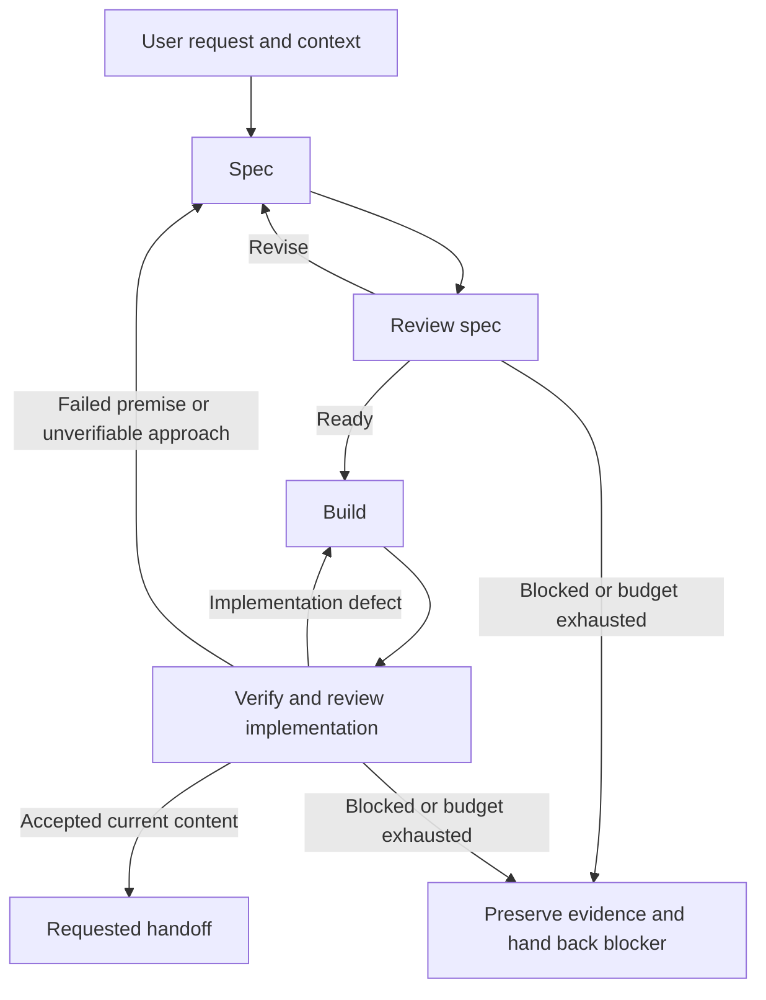

# Factory

Six skills for taking a software task from context to verified delivery. Factory coordinates two feedback loops and returns failed assumptions to the spec:



Factory **3.0.0** is a redesign candidate. It consolidates 17 skills into six and replaces seven overlapping playbooks with one task-proof reference. Existing verification scripts, delivery guards, design references, and marketplace identity remain. Old skill names are intentionally retired; see the [migration guide](docs/migration-v3.md).

| Skill | When to use it |
| --- | --- |
| [factory](plugins/factory/skills/factory/SKILL.md) | Own a task through both loops and the authorized handoff. |
| [spec](plugins/factory/skills/spec/SKILL.md) | Define an outcome and proof, or revise a failed assumption. |
| [design](plugins/factory/skills/design/SKILL.md) | Shape, build, and inspect the actual interface. |
| [review](plugins/factory/skills/review/SKILL.md) | Challenge a spec or implementation; coordinate independent review or a council. |
| [verify](plugins/factory/skills/verify/SKILL.md) | Prove the original outcome and route failures to the right loop. |
| [deliver](plugins/factory/skills/deliver/SKILL.md) | Hand off a branch, PR, merge, or deployment within the requested scope. |

Implementation stays in Factory rather than a skill that repeats basic coding instructions. Skills load specialized references only as needed. Review has bounded rounds; exhausted retries, unavailable reviewers, and missing proof never become approval. Council provider/model preferences belong in project instructions, not hardcoded in the plugin.

The [research and rationale](docs/research.md) compares Theo, Matt Pocock, and Potato using pinned primary sources, with Theo weighted most heavily. The two inner loops and outer return path come from Factory's intended workflow; the exact retry limits are Factory defaults.

## Install

Clone the branch or revision you intend to use:

```sh
git clone https://github.com/craig-ckc/factory.git
cd factory
# For this redesign candidate:
git switch refactor/factory-recursive-loops
```

Register that checkout:

```sh
claude plugin marketplace add /absolute/path/to/factory
claude plugin install factory@factory-local --scope user

codex plugin marketplace add /absolute/path/to/factory
codex plugin add factory@factory-local
```

For Cursor, use `.cursor-plugin/marketplace.json` as the marketplace manifest. All three harness manifests point to the same `plugins/factory` tree. The marketplace identifier remains `factory-local`.

To refresh an existing registered source after switching revisions:

```sh
claude plugin marketplace update factory-local
claude plugin update factory@factory-local
codex plugin add factory@factory-local
```

Check that the installed copy discovers the six current skills and no retired skills. Cache refresh and native harness behavior must be checked where that harness is available; manifest validation alone does not prove installation.

## Development and verification

Edit `plugins/factory`; keep its Codex, Claude Code, and Cursor manifest versions aligned. Python 3.10+ and Git are sufficient for the portable checks:

```sh
python3 scripts/check.py
python3 -m unittest discover -s tests -v
python3 plugins/factory/scripts/verification.py run . --manifest .factory/verification.json --evidence work/verification
```

Use a fresh evidence directory each run. See [project verification](plugins/factory/references/verification.md) for optional reusable contracts and [safe delivery](plugins/factory/references/delivery.md) for revision-bound acceptance and branch protection checks. These scripts remain independent of the conversational loop; there is no new scheduler, state database, or hook.

[Evaluations](evaluations/README.md) distinguish helper tests from actual agent behavior and preserve historical 2.2.0 receipts. The [previous implementation record](docs/remaining-tasks.md) is historical, not acceptance of this candidate.
